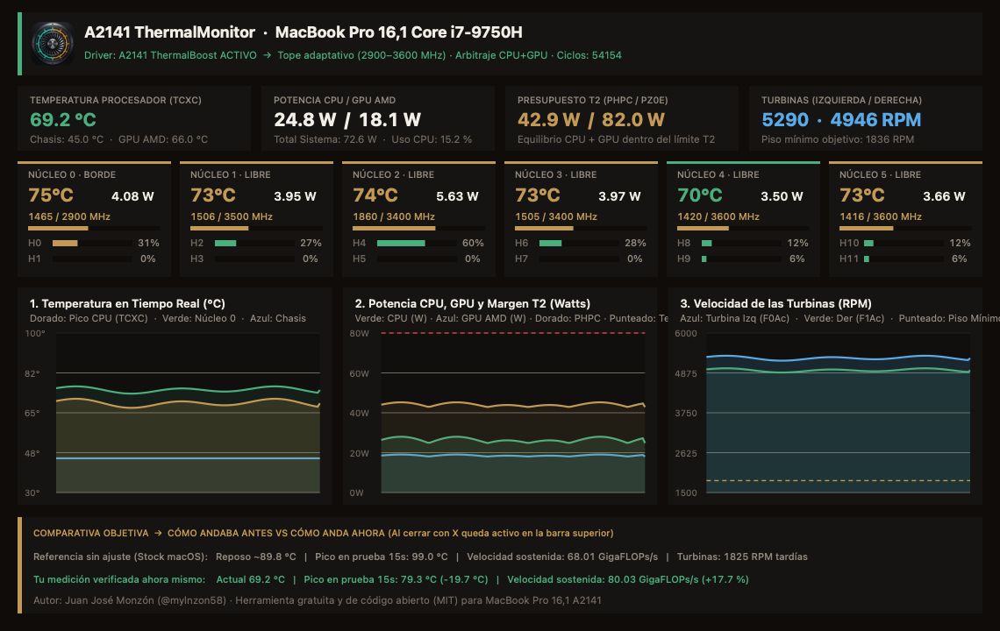

<p align="left">
  
</p>

# A2141 ThermalBoost — Driver de Control Térmico y Rendimiento para MacBook Pro 16" 2019 (A2141 · Core i7-9750H)

**Autor:** Juan Monzón · `@mylnzon58`  
**Web y guía paso a paso:** https://mylnzon58.github.io/t2-macbook-pro-16-1-thermal-performance-fix-macos/  
**Aplicación visual de monitoreo en tiempo real:** [A2141 ThermalMonitor (`mylnzon58/a2141-macos-thermal-monitor`)](https://github.com/mylnzon58/a2141-macos-thermal-monitor) · [Web del Monitor](https://mylnzon58.github.io/a2141-macos-thermal-monitor/)  
**Licencia:** MIT  

---

## Propósito de este proyecto

Comparto esta herramienta de código abierto para quienes usan una **MacBook Pro de 16 pulgadas de finales de 2019** y sienten que el equipo trabaja demasiado caliente incluso en tareas livianas, o que pierde velocidad cuando se le exige durante varios minutos.

De fábrica, macOS prioriza el silencio acústico: demora en encender los ventiladores hasta que el procesador ya está cerca de los 90 °C y reparte la carga de forma pareja entre todos los núcleos. Con los años de uso o al conectar pantallas externas, ese comportamiento suele traducirse en un teclado muy caliente y caídas bruscas de frecuencia.

Este proyecto nació de pruebas reales sobre mi propio equipo, apoyándome en herramientas de inteligencia artificial para analizar a detalle los registros del procesador y del controlador térmico, siempre bajo márgenes conservadores y con precaución. No pretende criticar el diseño original del sistema ni reemplazar herramientas existentes, sino ofrecer una alternativa práctica y medible para quienes quieran probar si este ajuste mejora la temperatura y la estabilidad en su máquina.

---

## En qué equipo funciona únicamente

Por precaución, el código verifica el hardware antes de actuar y **solo debe utilizarse en este modelo exacto**:

```
Modelo           →  MacBook Pro de 16 pulgadas de finales de 2019
Identificador    →  MacBookPro16,1 · Chasis A2141
Procesador       →  Intel Core i7-9750H de 6 núcleos y 12 hilos
Gráficos         →  AMD Radeon Pro 5300M o 5500M + Intel UHD Graphics 630
Controlador      →  Chip Apple T2
Sistema          →  macOS Catalina 10.15 hasta macOS Sequoia 15 o superior
```

*No está pensado para MacBooks con procesadores Apple Silicon M1, M2, M3 o M4, ni para otros modelos Intel con distinta disipación.*

---

## El problema y cómo lo abordamos

```
1. El núcleo 0 concentra interrupciones del sistema y calienta el resto del chip
   → Limitamos el núcleo 0 a 3.2 GHz y dejamos los núcleos 1 al 5 libres hasta 4.1 - 4.5 GHz.

2. Los ventiladores de fábrica tardan en reaccionar ante subidas rápidas de calor
   → Adelantamos la curva de ventilación de forma progresiva desde los 55 °C hasta los 78 °C.

3. Cuando la gráfica dedicada AMD está encendida, el presupuesto eléctrico total se reduce
   → Leemos en tiempo real el margen disponible en el chip T2 y ajustamos el consumo del procesador para evitar caídas bruscas de reloj.

4. El gestor de energía de macOS pisa cualquier ajuste manual cada pocos milisegundos
   → Pausamos esa sobreescritura mientras el servicio está activo y reaplicamos el perfil desde una extensión de kernel liviana cada 250 ms.
```

---

## Cómo medir tu equipo antes y después

La idea principal de este repositorio es que no tengas que confiar a ciegas: incluye una utilidad de consola llamada `a2141-ctl` para que puedas medir temperatura, consumo, revoluciones de ventiladores y velocidad de cálculo antes y después de activarlo.

### Flujo de medición recomendado

```
Medir estado original  →  Activar el servicio  →  Repetir la misma prueba de 15 s  →  Comparar tus números
```

En nuestro equipo de pruebas, midiendo en las mismas condiciones de escritorio con monitor externo y una prueba sostenida de 15 segundos en los 12 hilos, obtuvimos estos valores:

| Medición | Configuración original de macOS | Con el ajuste activo | Diferencia observada |
| :--- | :--- | :--- | :--- |
| **Temperatura en reposo** | `89.8 °C` | **`64.7 °C`** | **`-25.1 °C`** |
| **Temperatura máxima en prueba de 15 s** | `99.0 °C` | **`79.3 °C`** | **`-19.7 °C`** |
| **Velocidad de cálculo sostenida** | `68.01 GFLOPs/s` | **`80.03 GFLOPs/s`** | **`+17.7%`** |
| **Límite de velocidad del procesador** | Caídas por calor en el pico | **`100%` estable** | **Sin estrangulamiento** |
| **Ventiladores en reposo / carga** | `1825 RPM` fijos hasta tarde | **`3200` a `5250 RPM`** | **Respuesta anticipada** |

Cada equipo puede variar según el estado de su pasta térmica, la limpieza de las turbinas y la temperatura ambiente, por eso te invitamos a medir el tuyo y comprobar si te resulta útil.

### Aplicación visual para ver los núcleos y gráficas en tiempo real: A2141 Monitor

Para que sea aún más fácil e intuitivo corroborar cómo andaba tu Mac antes y cómo anda ahora, creamos una aplicación nativa y liviana en un repositorio hermano que puedes instalar en un minuto sin necesidad de desactivar SIP:

- **Repositorio de la App Visual:** https://github.com/mylnzon58/a2141-macos-thermal-monitor
- **Web de A2141 Monitor:** https://mylnzon58.github.io/a2141-macos-thermal-monitor/



Para instalar y abrir el monitor visual al instante en tu Mac:

```bash
git clone https://github.com/mylnzon58/a2141-macos-thermal-monitor.git
cd a2141-macos-thermal-monitor
chmod +x install.sh uninstall.sh
./install.sh
```

---

## Descargas directas ya compiladas (Sin necesidad de compilar)

Tanto el driver de kernel **A2141 ThermalBoost** (`A2141AsymmetricHWP.kext`), el demonio y medidor (`a2141-ctl`) como el monitor visual **A2141 ThermalMonitor** (`A2141Monitor.app`) ya están precompilados con sus íconos nativos de macOS e incluidos tanto en **Releases** como en la carpeta `prebuilt/`:

- **Instalador completo en un clic (`.pkg` — Instala Driver A2141 ThermalBoost + Demonio + Monitor Visual):**  
  **[Descargar A2141-ThermalBoost-v2.1.0-Installer.pkg](https://github.com/mylnzon58/t2-macbook-pro-16-1-thermal-performance-fix-macos/releases/download/v2.0.0/A2141-ThermalBoost-v2.1.0-Installer.pkg)**
- **Paquete completo precompilado (`.zip` con binarios e instalador):**  
  **[Descargar A2141-ThermalBoost-v2.1.0-Precompiled-macOS.zip](https://github.com/mylnzon58/t2-macbook-pro-16-1-thermal-performance-fix-macos/releases/download/v2.0.0/A2141-ThermalBoost-v2.1.0-Precompiled-macOS.zip)**
- **Solo Monitor Visual (`A2141 ThermalMonitor` en `.dmg`):**  
  **[Descargar A2141-ThermalMonitor-v1.1.0-macOS.dmg](https://github.com/mylnzon58/t2-macbook-pro-16-1-thermal-performance-fix-macos/releases/download/v2.0.0/A2141-ThermalMonitor-v1.1.0-macOS.dmg)**

> **Aviso de Gatekeeper la primera vez que abres un `.pkg` o `.dmg`:**  
> Como este es un proyecto gratuito de código abierto sin certificado comercial pago de Apple, macOS puede mostrar que *"no pudo verificar"* el archivo. Haz clic en **Listo**, ve a **Ajustes del Sistema → Privacidad y Seguridad → Seguridad** y presiona **"Abrir de todas formas"**. Si instalas desde Terminal con `./install.sh`, se autoriza automáticamente.

---

## Requisitos antes de instalar el driver de bajo nivel

1. **Para usar únicamente el Monitor Visual (`A2141 Monitor`) o el control de turbinas y energía (`a2141-ctl`):**  
   No necesitas desactivar SIP ni instalar herramientas de compilación; puedes abrir directamente el instalador `.pkg` o el `.dmg`.
2. **Para activar además la extensión de kernel (`A2141AsymmetricHWP.kext`) que controla los límites por núcleo en Ring-0:**  
   Como es un driver abierto sin firma comercial de Apple, macOS pide desactivar la restricción de extensiones desde Modo Recuperación (`csrutil disable`). Si además tienes las herramientas de Xcode instaladas (`xcode-select --install`), `install.sh` puede ajustar el `.kext` automáticamente a tu versión exacta de kernel; de lo contrario instala directamente el binario precompilado incluido en `prebuilt/`.

---

## Guía de instalación paso a paso

```
Paso 1: Modo Recuperación  →  Paso 2: Instalar (.pkg o ./install.sh)  →  Paso 3: Aprobar en Ajustes  →  Paso 4: Medir resultados
```

### Paso 1 → Desactivar la restricción en Modo Recuperación

1. Apaga tu Mac.
2. Enciéndela manteniendo presionadas las teclas **`Cmd (⌘) + R`** hasta ver el logo de Apple.
3. En la barra superior, abre **Utilidades → Terminal** y escribe:
   ```bash
   csrutil disable
   reboot
   ```

### Paso 2 → Instalar con el archivo `.pkg` o desde Terminal

**Opción A (Directa sin Terminal):** Descarga y abre **[A2141-ThermalBoost-v2.1.0-Installer.pkg](https://github.com/mylnzon58/t2-macbook-pro-16-1-thermal-performance-fix-macos/releases/download/v2.0.0/A2141-ThermalBoost-v2.1.0-Installer.pkg)**. Instalará automáticamente el driver **A2141 ThermalBoost**, el servicio en segundo plano y la aplicación **A2141 ThermalMonitor** en tu carpeta de Aplicaciones.

**Opción B (Por Terminal usando los binarios precompilados de `prebuilt/`):**
```bash
git clone https://github.com/mylnzon58/t2-macbook-pro-16-1-thermal-performance-fix-macos.git
cd t2-macbook-pro-16-1-thermal-performance-fix-macos
chmod +x install.sh uninstall.sh
sudo ./install.sh
```
*(Si deseas forzar la recompilación desde código fuente en tu equipo, puedes ejecutar `sudo ./install.sh --compile`).*

### Paso 3 → Autorizar el driver en Privacidad y Seguridad

La primera vez que se instala una extensión en versiones recientes de macOS:

```
Abrir Ajustes del Sistema  →  Privacidad y Seguridad  →  Presionar "Permitir" junto a A2141AsymmetricHWP  →  Reiniciar
```

### Paso 4 → Medir y verificar cómo funciona en tu Mac

Al volver del reinicio, puedes consultar los sensores y correr la prueba incluida:

```bash
# Ver temperatura actual, consumo en Watts, estado del driver y ventiladores
a2141-ctl status

# Ver una tabla en vivo que se actualiza cada segundo
a2141-ctl monitor 1000

# Correr una prueba de cálculo de 15 segundos para medir temperatura máxima y rendimiento
a2141-ctl benchmark 15
```

---

## Controles manuales opcionales

El servicio funciona solo en segundo plano, pero si quieres probar ajustes puntuales desde la Terminal puedes usar:

```bash
# Cambiar entre modo automático, respuesta rápida o carga pesada
sudo a2141-ctl profile auto
sudo a2141-ctl profile burst
sudo a2141-ctl profile heavy

# Ajustar el piso mínimo de los ventiladores o devolverlos al control automático
sudo a2141-ctl fans 3500
sudo a2141-ctl fans auto
```

---

## Cómo desinstalar y volver al estado original

Si después de medir sientes que no se adapta a tu uso o prefieres volver exactamente a la configuración de fábrica de macOS, puedes desinstalar todo en un solo comando:

```bash
sudo ./uninstall.sh
```

Esto detiene el servicio, descarga el driver, devuelve el control de energía y ventiladores a macOS y borra los archivos instalados. Si luego quieres volver a activar la protección SIP en Modo Recuperación, basta con ejecutar `csrutil enable` y reiniciar.

---

## Estructura del código

```
.
├── include/a2141_shared.h                 # Constantes y estructura de datos compartida
├── kext/
│   ├── A2141AsymmetricHWP.hpp             # Declaración de la extensión de kernel
│   ├── A2141AsymmetricHWP.cpp             # Lógica de perfiles por núcleo en el kernel
│   └── Info.plist                         # Metadatos de la extensión
├── cli/
│   ├── smc_client.h / smc_client.c        # Lectura de sensores térmicos y control de turbinas
│   └── a2141_ctl.c                        # Demonio de control, monitor en vivo y benchmark
├── launchd/com.juanmonzon.a2141-hwp.plist # Servicio de inicio automático
├── docs/                                  # Sitio web con guía y resultados de pruebas
├── Makefile                               # Reglas de compilación
├── install.sh                             # Instalador paso a paso
└── uninstall.sh                           # Desinstalador completo
```

---

## Apoyo al proyecto y contacto

Comparto este trabajo de manera libre por si a alguien con esta misma MacBook le sirve para trabajar más cómodo y cuidar su equipo. Si te ayudó a bajar las temperaturas o quieres apoyar el mantenimiento de mis herramientas abiertas:

- **GitHub Sponsors:** [github.com/sponsors/mylnzon58](https://github.com/sponsors/mylnzon58)
- **Patreon:** [patreon.com/JuanjoClassic](https://www.patreon.com/JuanjoClassic)
- **Invitar un Tecito:** [tecito.app/juanjoclassic](https://tecito.app/juanjoclassic)
- **LinkedIn:** [Juan José Monzón](https://www.linkedin.com/in/juan-m-97b85681/)
- **Más proyectos:** [github.com/mylnzon58](https://github.com/mylnzon58)
